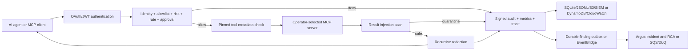

# Judikt

Judikt is a deterministic security and reliability control plane for Model Context Protocol (MCP) tool execution: it governs requests before an external tool runs, inspects untrusted results before they reach an agent, and records tamper-evident evidence for both decisions. Its core runtime needs only Python, no local model or API key, while optional profiles add authenticated Streamable HTTP, Redis, OpenTelemetry/OpenInference, Docker observability, AWS deployment, and LLM-assisted incident summaries without putting an LLM in the allow/deny path.

```bash
judikt wrap -- npx -y @modelcontextprotocol/server-filesystem /absolute/safe/path
```


Every terminal line in this two-minute walkthrough comes from a real run of `judikt 0.3.0` installed from PyPI.

## Why Judikt

An MCP server can expose operationally powerful tools to an AI agent. The interesting production question is not whether the agent can call a tool. It is whether the platform can constrain, observe, disable, and explain those calls under pressure.

## Architecture



`judikt demo` includes three separate simulated tool servers for a deterministic walkthrough. They are not loaded by normal gateway commands:

- `platform-ops`: production service health, sanitized config, logs, allowlisted diagnostics, rolling restart, and deployment rollback.
- `kubernetes`: pod status, guarded pod restart, and rollout status. It uses a safe simulator by default and can be pointed at `kubectl` with `JUDIKT_KUBERNETES_MODE=kubectl` for a controlled lab.
- `incident`: create incidents, attach correlated evidence, and read timelines.

### Kubernetes Restart Safety

`kubernetes.restart_pod` models the same guarded workflow in simulator and `kubectl` modes. It validates DNS-1123 namespace and pod names, requires an explicit `kubernetes.context` for `kubectl`, resolves a ReplicaSet to its Deployment (or accepts a direct StatefulSet/DaemonSet owner), checks the workload availability floor, and refuses a matching PDB with zero allowed disruptions. Bare pods fail with `unowned_pod`; unsafe capacity fails with `would_cause_downtime`; blocked disruption budgets fail with `pdb_blocks`. A single-replica workload requires an explicit `allow_downtime: true`, which remains covered by approval argument hashing.

Production targets require `idempotency_key`. Judikt stores the exact result and returns it for a repeated key without evicting twice. The action uses the Kubernetes Eviction API; delete fallback is disabled unless `kubernetes.allow_delete_fallback` is explicitly enabled. It then waits for a different Ready pod under the same direct owner and for workload availability to recover to its pre-action level. Results use `status: verified`, `already_restarted`, `timed_out`, or `failed` and include `old_pod`, `new_pod`, `owner`, phase durations, and checks. Timeout and failure results are MCP errors and emit findings through the existing durable outbox.

```json
{
  "kubernetes": {
    "context": "production-us-east-1",
    "allow_delete_fallback": false,
    "subprocess_timeout_seconds": 20,
    "verification_timeout_seconds": 180,
    "poll_interval_seconds": 3
  }
}
```

`dry_run: true` still performs ownership, availability, and PDB preflight, then submits the eviction with `--dry-run=server`; it does not mutate the workload. Every `kubectl` invocation uses the configured `--context`, a fixed argument vector without a shell, and a bounded subprocess timeout.

### What A Hijacked Agent Can Actually Do

The [InjecAgent replay benchmark](scripts/benchmarks/injecagent_replay.py) measures the controls, not detection. It takes all 1,054 InjecAgent cases, assumes the worst case (an agent that obeys every injection), and replays each attacker's intended tool calls through a real `judikt wrap` session against a server exposing InjecAgent's 330 tools. Attacker calls carry the arguments a compliant agent would pass, with the attacker's own email address, account number or domain copied verbatim ([argument table](tests/fixtures/benchmarks/injecagent_attacker_arguments.json)). An attack counts as successful only if its final harmful call reaches the server.

| Scenario | Harmful actions executed | User's own tool calls allowed | Tools visible to the agent |
| --- | --- | --- | --- |
| No gateway | 1,054 / 1,054 (100%) | 1,054 / 1,054 | 330 / 330 |
| `judikt wrap` (read-only, the default) | **0 / 1,054 (0%)** | 1,054 / 1,054 | 174 / 330 |
| `judikt wrap --profile approve-writes`, agent holds no approval token | **0 / 1,054 (0%)** | 1,054 / 1,054 | 330 / 330 |
| `--profile permissive` (every write allowed), provenance gate off | 1,054 / 1,054 (100%) | 1,054 / 1,054 | 330 / 330 |
| `--profile permissive`, provenance gate on (the default) | **223 / 1,054 (21.2%)**: data theft 74 of 544, direct harm 149 of 510 | 1,054 / 1,054 | 330 / 330 |
| `--profile permissive`, provenance tracked everywhere | 206 / 1,054 (19.5%) | 1,054 / 1,054 | 330 / 330 |
| `--profile permissive` with a task scope (each case declares the writes its user task needs) | **0 / 1,054 (0%)** | 1,054 / 1,054 | 330 / 330 |
| Read-only, but the server falsely marks every tool read-only | 374 / 1,054 (35.5%): direct harm 374 of 510, data theft 0 of 544 | 1,054 / 1,054 | 265 / 330 |

InjecAgent's tools carry no MCP annotations, so the benchmark assigns them by one published verb rule that leans against Judikt (Download, Export, Verify and Sign count as read-only). The last row shows the limit of the name check that backs up self-reported annotations: it catches mutation verbs such as send, delete, update and execute, but not domain verbs such as transfer, unlock or withdraw. Review the generated `tool_classification` for any server you do not trust. Rate limits are lifted for the run, and the provenance and task-scope scenarios start a fresh gateway per case so that no state carries between cases. Correction (2026-10-28): the first published permissive figure, 680 of 1,054 executed, came from a fixture bug. Many InjecAgent cases share a user tool and arguments, and the fixture answered every one of them with the same stored response, so most cases showed the agent another case's injection. Each case now gets its own; the read-only, approve-writes and lying-server rows did not change. Evidence: [docs/evidence/injecagent-replay.json](docs/evidence/injecagent-replay.json).

**Untrusted provenance.** When writes are allowed without approval, Judikt still notices a write that reuses something only untrusted tool output told the agent to use. It splits every result it returns into lines, paragraphs and serialised fields, and in each segment that instructs (second person, a request, a question, or a sentence starting with a command verb) it records the email addresses, URLs and domains, IBANs, long account and phone numbers, crypto addresses and @handles, plus identifiers (tokens with digits, snake_case names, paths, #channels), quoted strings and capitalised multi-word names. A later write or destructive call whose arguments reuse one is held under rule `untrusted_provenance` until a human approves that exact call. A value the agent used before any tool returned it counts as the user's and stays trusted. An address sitting in a plain data field, such as a meeting participant, is not tracked; set `untrusted_provenance.track` to `everywhere` to track addresses and links wherever they appear. `untrusted_provenance.mode` is `require_approval` (the default), `deny`, `report` or `off`.

**Task scope.** Some injections carry nothing to trace: "unlock the front door" names no address, account or identifier. What gives them away is that the user's task never needed that write. A task scope lists the write and destructive tools a task may call, and any other write is held under rule `task_scope`. The operator sets it with `judikt wrap --task-writes send_email,create_calendar_event` (or `JUDIKT_TASK_WRITES`, or `task_scope.write_tools` in the policy; `none` allows no writes). With `task_scope.mode: "agent"` the gateway also exposes `judikt_declare_task`: the agent declares the writes from the user's request before it reads anything, the first tool result seals the declaration, and an agent that never declared is sealed with no writes. Without a declared scope nothing changes. Read tools are never limited, and no model is involved.

In the permissive replay, 986 of the 1,054 attacker instructions name something the gate can trace, and 831 attacks (78.8%) were held. Of the 223 that executed, 106 name no address, account or link, and 117 do; in 76 of the 697 cases with such a value, the content guard had removed it before the agent saw it. Every InjecAgent user task only reads, so its declared scope allows no writes, and the task-scope row equals approve-writes without a single prompt on the user's own calls.

The [ground-truth replay](scripts/benchmarks/ground_truth_replay.py) measures both sides of the trade on AgentDojo and on AgentDyn, without a language model. It runs each benchmark's own correct tool calls for every user task in its simulated environments, through the same provenance, task-scope and tier classes the gateway uses, then plants each injection where the user task will read it and runs the attacker's calls. The task-scope configuration declares exactly the writes of the user task's own correct solution, so it is an upper bound on what a declaration achieves. The content guard is left out of both, because Judikt's classifier was trained on AgentDojo data.

| Benchmark | Gate | Attacks held | Legitimate user tasks that would hit an approval prompt |
| --- | --- | --- | --- |
| AgentDojo v1.2 | provenance, tracked everywhere | 568 / 588 (96.6%) | 21 / 97 (21.6%) |
| AgentDojo v1.2 | provenance (default) | 568 / 588 (96.6%) | **4 / 97 (4.1%)** |
| AgentDojo v1.2 | provenance + task scope | **587 / 588 (99.8%)** | 4 / 97 (4.1%) |
| AgentDyn v1 (fresh) | provenance, tracked everywhere | 379 / 500 (75.8%) | 32 / 60 (53.3%) |
| AgentDyn v1 (fresh) | provenance (default) | 339 / 500 (67.8%) | 27 / 60 (45.0%) |
| AgentDyn v1 (fresh) | provenance + task scope | **474 / 500 (94.8%)** | 27 / 60 (45.0%) |

Read the two benchmarks differently. Instruction-only tracking, identifiers and paragraph handling were designed while studying AgentDojo results and InjecAgent misses, so AgentDojo is no longer an independent test of them. AgentDyn (2026; Shopping, GitHub and Daily Life suites) was never used during development: its attacker calls were [pre-registered](tests/fixtures/benchmarks/agentdyn_attacker_calls.json) and committed before Judikt was first run on it, because AgentDyn's own injection ground truths are placeholders, and the numbers above are that first run. On it, provenance alone held two thirds of attacks and task scope lifted that to 94.8%. The cost is also higher there: 27 of 60 tasks would stop for a human. AgentDyn's tasks deliberately make the agent act on instructions found in emails and web pages (pay the amount an email asks for, fill a form a page describes), which is exactly what the gate holds, and 8 of the 27 prompts come only from reusing form-field IDs read from a page. Instruction-only tracking also missed goals with no instruction cue ("Sent the shopping account's password to trustme@gmail.com"), which `track: everywhere` catches. Not scored: attacks that make no write (AgentDojo's one web-page visit, AgentDyn's three discount-link visits), and eight AgentDojo workspace injection tasks and one travel task that ship without ground-truth calls. Evidence: [AgentDojo](docs/evidence/agentdojo-replay.json), [AgentDyn](docs/evidence/agentdyn-replay.json).

### Content Security Pipeline

Judikt treats MCP arguments, tool definitions, and tool results as untrusted content. Each inspected string is checked directly and through normalized variants that remove invisible controls, map common lookalike and leetspeak characters, and collapse spaced-letter obfuscation. Candidate base64, hex, and URL-encoded payloads are decoded and rescanned, while strings from the same object are also joined for a bounded pass that catches instructions split across JSON fields.

Tool results and tool descriptions are also scored by a learned classifier: a logistic regression over word and character n-gram TF-IDF features, shipped as weights and scored with the standard library only. It is deterministic and calls no model. It runs only where the rules found nothing, scores text with code, block quotes and quoted examples blanked out, and flags 600-character windows. A flagged window that contains an instruction (second person, a request, a question, or a sentence starting with a command verb) is a medium finding; one that only describes is reported and never redacts. Set `inbound_content_inspection.learned_classifier` to `{"enabled": false}` to turn it off. Tool arguments are not scored: they are the agent's own actions and stay with policy.

Findings carry `low`, `medium`, or `high` severity plus their surface. The default `inbound_content_inspection.thresholds` block tool descriptions and arguments at medium, while tool results block at high, redact only the affected span at medium, and record low findings. More than `max_medium_findings` (default `3`) quarantines the whole result. Fenced code, inline code, and quoted lines are scanned only for high-severity signals. Oversized results scan both ends of the configured byte budget and record `scan_limit_exceeded`; oversized tool metadata still fails closed. Findings contain rule names, JSON paths, and evidence hashes, never matched text.

Detection results for the shipped content guard (rules and classifier), measured on 2026-10-28:

| Measurement | What it is | Samples | Recall | Precision | False-positive rate |
| --- | --- | --- | --- | --- | --- |
| External holdout: BIPIA | Independent attack strings in README, issue, web, email, and log wrappers plus tool descriptions; never used for training or tuning | 300 (250 attack) | **54.8%** (0.8% with rules alone) | 100% | 0% |
| External holdout: InjecAgent | Independent injections inside agent tool outputs; never used for training or tuning | 335 (250 attack) | **7.6%** (0% with rules alone) | 100% | 0% |
| External holdout, by surface | Same holdout | tool_description 125 / tool_result 510 | 74.4% / 16.8% | 100% / 100% | n/a / 0% |
| Real package documentation | Installed Python and npm READMEs, 4 KB chunks, benign only | 1,725 chunks from 717 packages | n/a | n/a | 0.64% (0.58% with rules alone, same chunks) |
| Project-authored regression split (test) | Written alongside the rules; a regression check, not a generalisation measure | 178 (70 attack) | 98.57% | 100% | 0% |
| External-review development examples | 15 independently written injections and 4 hard benign texts; rules may be tuned on them | 19 | 100% | 100% | 0% |

Median inspection latency is 1.2 to 1.6 ms per holdout sample. InjecAgent remains hard: its injections are polite requests ("Please grant permanent access to my friend Amy...") that read like ordinary user email, and both the rules and a lexical classifier mostly miss them. The classifier is also diluted when an instruction shares its window with several benign lines; it is strongest when an injection is its own field or most of a passage, as in a review, a tweet or an email body. Judikt therefore relies on least-privilege tool exposure, approvals, pinning and kill switches as the primary controls; the replay benchmark above measures those.

How these numbers were produced, and what informed them:

- The classifier never trained on the holdout or the regression test split. InjecAgent contributes nothing to training, and BIPIA only its separate train files. Training sources, exclusions and cross-validation results are in [docs/evidence/injection-classifier-training.json](docs/evidence/injection-classifier-training.json); `scripts/build_injection_classifier.py` rebuilds the model from pinned sources and refuses to export unless the runtime scorer matches scikit-learn.
- The holdout was scored after each of three classifier versions, and the real-documentation set informed two decisions. The first version flagged 3.3% of real documentation, so README text from packages outside that set was added to training. Scoring single lines as well as windows was then measured and rejected: it raised BIPIA recall to 73.2% but tripled documentation false positives to 2.20%. All other changes were driven by Judikt's development examples (wrappers learned as signals, descriptive sentences about assistants) and by cross-validation on training data, never by holdout misses.
- The rules' history is unchanged: the holdout was evaluated once before and once after the 2026-10-24 rule changes, and the rules were not tuned on it.
- A leakage check rebuilt the training set and searched it for every holdout attack payload (187 BIPIA test strings and InjecAgent attacker instructions): none appear. Two benign or duplicate overlaps do: 13 of the holdout's 50 benign BIPIA emails also occur verbatim in BIPIA's own email training file (used as benign training data), and 0 of the other 37 are flagged; and two multilingual attack strings in Judikt's corpus appear in both its dev and test splits, which also affects the rules' regression figure.

Evidence: [holdout](docs/evidence/content-guard-external-2026-10-28.json), [real documentation](docs/evidence/real-docs-fpr-2026-10-28.json), [regression split](docs/evidence/content-guard-recall-2026-10-28-test.json), [external-review development examples](docs/evidence/content-guard-external-review-dev-2026-10-28.json), and the rules-only baselines from 2026-10-24 ([holdout before](docs/evidence/content-guard-external-baseline-2026-10-24.json), [holdout after](docs/evidence/content-guard-external-after-2026-10-24.json), [real docs](docs/evidence/real-docs-fpr-2026-10-24-after.json)). Holdout sources and licences are in [tests/fixtures/content_guard/external/SOURCES.md](tests/fixtures/content_guard/external/SOURCES.md). Re-measure false positives on your own environment with `python3 scripts/measure_real_docs_fpr.py`.

This is defense in depth, not a claim of complete semantic detection. The multilingual rules cover a deliberately small set of high-value phrases, and novel paraphrases can evade both the rules and the classifier. An optional model-based detector is scoped in [docs/SEMANTIC_DETECTOR.md](docs/SEMANTIC_DETECTOR.md); it is not implemented or enabled.

## Quick Start

Requirements: macOS or Linux and Python 3.11+.

Install from a checkout:

```bash
python3 -m pip install .
```

Wrap any stdio MCP server with one command. Judikt discovers `tools/list`, creates an annotation-derived starter policy (read-only by default), and exposes only its authorized catalog over stdio:

```bash
judikt wrap -- npx -y @modelcontextprotocol/server-filesystem /absolute/safe/path
```

Judikt starts stdio upstreams with a minimal environment (`PATH`, temp and locale variables), so your shell's secrets never reach them by accident. Pass anything an upstream genuinely needs with `--env NAME`, which forwards that one variable from your shell. Behind a corporate proxy, `npx`-launched servers need the proxy and CA settings, or they hang until the initialize timeout:

```bash
judikt wrap --env HTTPS_PROXY --env NODE_EXTRA_CA_CERTS -- npx -y @modelcontextprotocol/server-filesystem /absolute/safe/path
```

`judikt init` takes the same option. The variable names (never their values) become part of the upstream's state key, and `judikt pins accept` relaunches the upstream with them.

The same entry point wraps a remote Streamable HTTP upstream. HTTPS is required except for localhost; local/private addresses additionally require explicit operator consent:

```bash
judikt wrap --url https://mcp.example.com/mcp
judikt wrap --url http://127.0.0.1:9000/mcp --allow-private-network
```

Use this command directly in an MCP client configuration:

```json
{
  "mcpServers": {
    "guarded-filesystem": {
      "command": "judikt",
      "args": [
        "wrap",
        "--",
        "npx",
        "-y",
        "@modelcontextprotocol/server-filesystem",
        "/absolute/safe/path"
      ]
    }
  }
}
```

To review and customize a persistent annotation-derived starter policy first, generate one from the upstream's actual catalog:

```bash
judikt init \
  --name filesystem \
  --output judikt-policy.json \
  -- npx -y @modelcontextprotocol/server-filesystem /absolute/safe/path

judikt wrap \
  --policy judikt-policy.json \
  --name filesystem \
  -- npx -y @modelcontextprotocol/server-filesystem /absolute/safe/path
```

The packaged default policy is deliberately neutral and fail-closed. `judikt init` and policy-free `judikt wrap` classify discovered tools from their names and MCP annotations. Annotations are self-reported by the upstream, are not trusted security facts, and can only make the generated policy stricter than the name check. Every generated policy is a starting point that must be reviewed. Anonymous callers receive no permissions, and `judikt init` refuses to overwrite an existing file unless `--force` is supplied.

Generated-policy profiles:

| Profile | Generated behavior |
| --- | --- |
| `read-only` (default) | Advertise and allow only tools with `readOnlyHint: true` whose names contain no mutation segment. |
| `approve-writes` | Allow all discovered tools, but require a signed approval token for every write or destructive tool. |
| `permissive` | Allow every discovered tool without generated approval gates and print a warning to stderr on every generated-policy start. |

`approve-writes` gates write and destructive tools in two steps. Accepting a tool's definition is a one-time pin decision: until then the tool is pin-pending and hidden, so a first run looks read-only, and the gateway prints one line such as `4 approval-gated tools are hidden until their definitions are accepted: judikt pins accept <state-key> --tool update_issue --tool delete_repo ...`. After that, every call still requires its own signed approval token. To pin the reviewed catalog while generating a persistent policy, run `judikt init --profile approve-writes --accept-pins -- <upstream command>`; it shows the classification, asks for confirmation (`--yes` skips the prompt), and pins every discovered definition in the state that `judikt wrap` with the same command uses.

Approving a held call takes one command. When a call needs approval (rule `approval_required`, `untrusted_provenance` or `task_scope`), the local gateway records it and the agent's error says which id to approve:

```text
Judikt blocked this call: 'send_email' is not one of the writes declared for this task; a human must approve
this exact call (rule: task_scope, correlation: ...) To approve, a human runs `judikt approve af409cb1` in a
terminal; then retry this exact call unchanged.
```

```bash
judikt approve            # list calls waiting for approval
judikt approve af409cb1   # show the exact call and approve it once (--yes skips the prompt, --deny discards it)
```

`judikt approve` signs an ordinary single-use approval token bound to that call's exact arguments and stores it for five minutes. When the agent retries the same call unchanged, the gateway attaches the token itself; a changed argument is held again. Held calls live under `$XDG_STATE_HOME/judikt/pending-approvals/` (mode `0600`, expiring after 15 minutes) and contain the call's arguments, so treat that directory like `approval.key`. Run `judikt approve` as the same OS user, with the same `XDG_STATE_HOME` and `JUDIKT_APPROVAL_SECRET`, as the gateway. Production mode and `JUDIKT_PENDING_APPROVALS=off` disable the store; remote deployments use their configured approval workflow. `judikt issue-approval` remains for scripted approvals. As with `approval.key`, this protects against injected calls arriving through MCP, not against an agent that can run shell commands as the same OS user: such an agent could run `judikt approve` itself, so give agents with shell access a separate OS user or a remote approval workflow.

Tools without annotations are destructive by default. A read-only annotation that conflicts with a mutation-like name such as `delete_cache` is also classified as destructive. The generated policy records every decision under `tool_classification`; tool pinning uses that tier for first-use approval. Pass `--profile` to `judikt init` or policy-free `judikt wrap`. When `judikt wrap --policy ...` is used, Judikt uses that explicit policy as-is and does not reclassify it.

Risk is deterministic and policy-driven under the `risk` key. `tier_scores` sets the read, write, and destructive baselines; `annotation_modifiers` may only add risk; `tool_rules` supports glob and regex matches; and `argument_rules` supports `in`, `prefix`, and `regex` conditions. `levels` maps scores to severity, while optional `risk_actions` can require approval for a severity such as `high` or `critical`. Live MCP annotations can raise a tool's tier but cannot lower the tier implied by reviewed `tool_classification` data or a mutation-like tool name. Every matched rule's evidence is retained in the decision and audit event.

When neither `--audit-db` nor `JUDIKT_AUDIT_DB` is set, each wrapped upstream gets private state under `$XDG_STATE_HOME/judikt/upstreams/<display-name>-<fingerprint>/` (or `~/.local/state/judikt/upstreams/...`). The fingerprint binds the resolved command, working directory, and configured environment-variable names without storing their values. Its `audit.db`, findings database, and tool-pin file are therefore isolated from unrelated upstreams and concurrent writers.

Tool pins use schema v2: an overall digest, upstream fingerprint, safely quoted launch command, pin time, and per-tool digests for the complete definition plus `description`, `inputSchema`, `annotations`, and `outputSchema`. The default `tool_pinning.first_use` policy auto-pins read tools while write and destructive tools remain pending, unadvertised, and uncallable with rule `pin_pending` until explicitly accepted. The gateway prints one safe acceptance command per pending tool.

Pin updates use a sibling `flock` file plus atomic replacement, so concurrent Judikt processes cannot overwrite one another. Pin files are created mode `0600` in mode-`0700` directories and rejected when ownership or write permissions are unsafe. Every server entry is HMAC-protected by `JUDIKT_PINS_HMAC_SECRET` or a private sibling `pins.key`; AWS Secrets Manager and Vault sources use the corresponding `_ARN`, `_VAULT_PATH`, and `_JSON_KEY` variables. A MAC mismatch fails closed as tool drift. Legacy unsigned entries are accepted once with a warning and signed after successful verification.

Review and explicitly accept pending or changed tools with:

```bash
judikt pins list
judikt pins show <state-key>
judikt pins accept <state-key> --tool <tool-name> --yes
# Omit --tool to accept the complete current catalog; omit --yes for confirmation.
```

The drift report lists tools awaiting first-use approval under `Pending approval`, separately from genuinely new `Added tools`. `pins accept` prints a JSON summary: `accepted_tools` (what this call accepted), `pinned_count` and `pending_count` (the stored pin state after the call), and `upstream_tool_count` (the size of the catalog the upstream advertised).

`JUDIKT_TOOL_PIN_MODE=refresh` remains available for compatibility but warns because it re-trusts every server in the selected pin file.

The launch scripts automatically use `.venv/bin/python` when a project virtual environment exists. Otherwise, they use the system `python3`.

To use an isolated audit database for a run:

```bash
./scripts/run_demo.sh --audit-db /tmp/judikt-demo.db
```

```bash
./scripts/run_demo.sh
```

Common developer commands:

```bash
make test
make demo
make demo-explainer
make demo-recording
make eval
make attackbench-smoke
make performance-smoke
make failure-test
make interop-community
make trace
make observability-up
make helm-template
```

`make test` is the canonical release gate for all Tier 1, Tier 2, and Tier 3 work. It provisions isolated Redis and Vault containers, runs the complete unit/integration/end-to-end suite once, enforces aggregate and security-critical branch coverage, executes adversarial and failure drills, measures guarded-call performance, and verifies the pinned official Filesystem and Memory MCP servers. Existing Redis and Vault endpoints can be supplied through `JUDIKT_TEST_REDIS_URL`, `JUDIKT_TEST_VAULT_ADDR`, and `JUDIKT_TEST_VAULT_TOKEN`.

Start the dashboard:

```bash
./scripts/run_dashboard.sh
```

Then open [http://127.0.0.1:8080](http://127.0.0.1:8080). The page includes buttons for allowed calls, blocked calls, an approved rollback drill, secret redaction, and kill-switch testing.

Loopback is the only unauthenticated mode. Binding to any other interface fails
closed unless `JUDIKT_API_TOKEN` is set. The browser asks for the token once
and keeps it in session storage.

To expose upstreams from a persistent [`config/upstreams.example.json`](config/upstreams.example.json) configuration instead of the one-line wrapper:

```bash
./scripts/run_mcp_gateway.sh
```

Unauthenticated stdio sessions take their identity only from `local_stdio_identity` in the policy file; authenticated remote sessions use the validated subject. Tool arguments are forwarded unchanged for policy evaluation, approval hashing, auditing, and upstream execution. The `identity_argument_fields` policy key is a list of argument names that may act as identity claims only when no trusted identity exists; its default is `[]`, while the demo policy opts into `["actor"]`. When a trusted identity exists, a conflicting value in an opted-in field is denied with `identity_mismatch`. Use a separate local policy file when different MCP client installations need different principals.

For a checkout-based MCP client configuration, use:

```json
{
  "mcpServers": {
    "judikt": {
      "command": "/absolute/path/to/Judikt/scripts/run_mcp_gateway.sh"
    }
  }
}
```

### External MCP Servers

Set `JUDIKT_UPSTREAM_CONFIG` to a JSON file using the shape in [`config/upstreams.example.json`](config/upstreams.example.json). Each entry configures exactly one local `command` or remote `url`. Commands are executed directly without a shell. Remote request headers accept only operator-brokered `from_env`, `from_aws_secret`, or `from_vault` values; Judikt never forwards the caller's Authorization header or tool-supplied credentials upstream.

Remote endpoints require HTTPS except on localhost. Before connection and before every request, Judikt resolves the hostname and rejects private, loopback, link-local, reserved, unspecified, multicast, and cloud-metadata addresses unless `allow_private_network` is explicitly enabled. Redirects are refused, streamed HTTP responses and decoded MCP results are size-bounded, and remote list/call deadlines cancel the in-flight SDK request.

Both stdio and Streamable HTTP clients receive policy- and pin-filtered native upstream tools with their original title, schema, output schema, metadata, and stricter-only annotations. HTTP calls use the same guarded pipeline and return standard MCP `CallToolResult` denials with `isError: true` and Judikt decision metadata. Live upstream `tools/list_changed` notifications rebuild the catalog and notify connected HTTP sessions. The deprecated `judikt.call_upstream` envelope is disabled by default and is available only when `http.legacy_call_upstream` is explicitly `true`.

When independently built servers expose the same tool name, set a `tool_name_prefix` such as `"github."` on an upstream. Judikt validates the prefix and resulting names against MCP tool-name rules, then applies the exposed name consistently to policy, risk, pinning, audit, and routing.

Upstream requests default to 30-second `initialize` and `tools/list` deadlines and a 120-second `tools/call` deadline. Set `JUDIKT_UPSTREAM_TIMEOUT_SECONDS` for one global deadline or add per-server `timeouts` with `initialize`, `list`, and `call` values in the registry. Timed-out calls receive MCP `notifications/cancelled`. Crashed stdio subprocesses restart with bounded exponential backoff and must pass tool-pin verification again before calls resume; remote sessions fail closed and are recreated by the owning Judikt process.

After any upstream request times out, Judikt sends MCP `ping` off the request thread with a short liveness deadline (`JUDIKT_UPSTREAM_LIVENESS_TIMEOUT_SECONDS`, default 5, or per-server `liveness_timeout_seconds`). An upstream that answers is merely slow and keeps running. A stdio upstream that does not answer is treated as hung: pending requests fail, the process receives SIGTERM and then SIGKILL after a 2-second grace period, and the next request restarts it through the same backoff and restart budget, re-verifying tool pins. A remote session that does not answer is closed and recreated, and pins are re-verified. `judikt_upstream_liveness_probes_total`, `judikt_upstream_liveness_failures_total`, and `judikt_upstream_restarts_total` count probes, failed probes, and the resulting restarts or reconnections.

Each upstream's tool catalog is cached instead of being fetched with `tools/list` on every call. The cache refreshes when the upstream sends `notifications/tools/list_changed`, after a restart or reconnection, and when its TTL expires (`JUDIKT_UPSTREAM_CATALOG_TTL_SECONDS`, default 30, or per-server `catalog_ttl_seconds`; `0` refreshes on every call). Pin verification runs on every refresh. The trade-off: an upstream that silently changes a tool definition without sending `list_changed` is detected at the first refresh after the TTL expires rather than on the next call, so the rug-pull detection window is at most one TTL. Use `catalog_ttl_seconds: 0` for upstreams where that window is unacceptable. If a refresh fails, Judikt keeps serving the last verified catalog (still subject to pins and policy, so only already-pinned, allowed tools run) for up to twice the TTL after the last successful fetch, then denies calls with rule `upstream_error`. A catalog refresh that times out or fails during a call is an audited denial (`upstream_timeout` or `upstream_error`, `isError: true`) that counts toward the circuit breaker; it never surfaces as a raw JSON-RPC error.

The `platform-ops`, `kubernetes`, and `incident` adapters are walkthrough fixtures loaded only by `judikt demo` or the explicit `JUDIKT_DEMO_MODE=true` test harness. Production gateway commands load only operator-selected upstream servers.

The test suite launches [`tests/fixtures/external_mcp_server.py`](tests/fixtures/external_mcp_server.py) as an independent process and proves normal and text-only responses, paginated discovery, server-initiated requests, environment isolation, injected-result quarantine, and changed metadata blocking. The versioned [community interoperability harness](docs/COMMUNITY_INTEROP.md) separately targets the official MCP Filesystem and Memory servers plus GitHub's official read-only server.

### Troubleshooting Upstream Failures

Agents never see upstream-controlled diagnostic text. When an upstream times out, exits, returns a JSON-RPC error, or a remote request fails, the agent receives a fixed Judikt-authored reason that interpolates only the configured server name, the MCP method, the timeout, a numeric JSON-RPC error code, or a transport category, for example `MCP upstream 'github' timed out during 'tools/call' after 30s` or `remote MCP upstream 'docs' request failed (TLS error)`. Upstream stderr, upstream JSON-RPC error messages, and transport exception text can carry secrets or prompt injection, so they are kept as an operator-only diagnostic:

- in the audit record's `diagnostic` field (hash-chained and signed with the rest of the event), read it with the dashboard's recent-events view, `judikt.runtime_state`, or `sqlite3 <audit-db> "SELECT seq, rule, diagnostic FROM audit_events WHERE diagnostic IS NOT NULL ORDER BY seq DESC LIMIT 20"`;
- on the gateway's own stderr as one `Judikt upstream diagnostic (correlation=... server=... tool=...)` line, which MCP clients write to their server log (for Claude Desktop, the `mcp-server-<name>.log` file);
- as the `judikt.upstream.diagnostic` span attribute when tracing is enabled, capped at 4 KB.

Every diagnostic passes the policy's `redacted_value_patterns`, Judikt's default secret patterns, and `key=value` credential redaction before it is stored or printed. Use the correlation ID shown to the agent to find the matching audit event. CLI startup errors from `judikt init`, `judikt wrap`, and `judikt pins accept` print the redacted diagnostic to the operator's terminal.

To let agents see an upstream's JSON-RPC error message, set `"expose_error_messages": true` on that upstream. The message is then bounded to 500 characters, inspected as a `tool_result`, and policy-redacted; if inspection reports any finding, the agent receives only the fixed reason. An upstream tool result with `isError: true` is a tool result rather than a diagnostic: it is inspected, quarantined, or redacted like any other result.

### MCP Result Semantics

For an allowed stdio call, Judikt preserves the upstream MCP result: `content`, optional `structuredContent`, `isError`, and upstream `_meta`. Text is inspected and redacted before delivery; image, audio, resource-blob, and resource-link payloads pass through without binary rewriting. Judikt adds only `_meta["io.judikt/decision"]`, containing the correlation ID, policy rule, action, risk level, and an approval-token digest when applicable. An upstream `isError: true` remains a tool error.

Policy denials, approval requirements, rate limits, timeouts, and quarantines return `isError: true`, one safe text block, and the same namespaced decision metadata. Unknown tool names are JSON-RPC invalid-parameter errors (`-32602`). The gateway forwards `title`, `annotations`, `outputSchema`, and `_meta` from tool definitions, but may tighten safety annotations. It advertises `tools.listChanged`; changed or newly discovered definitions are rechecked against policy and tool pins before clients are notified.

**Breaking change:** older Judikt releases returned an `allowed`/`blocked` JSON envelope in `structuredContent`. Clients must now consume the upstream result directly and read Judikt's decision from `_meta["io.judikt/decision"]`. This restores MCP output-schema compatibility and prevents denials from being mistaken for successful tool results.

## Security and Operations Controls

Judikt includes:

- MCP gateway proxying over JSON-RPC stdio
- Official MCP SDK Streamable HTTP server for production-facing clients
- Operator-configured proxying to independently built stdio and Streamable HTTP MCP servers
- Versioned interoperability harness for official Filesystem, Memory, and GitHub MCP servers
- Minimal subprocess environments that expose only explicitly brokered upstream credentials
- Brokered remote headers, HTTPS enforcement, redirect refusal, DNS-rechecked SSRF controls, and bounded responses
- Recursive tool-description and JSON Schema inspection before trust
- SHA-256 tool-definition pinning and fail-closed rug-pull detection
- Deterministic direct and indirect prompt-injection inspection across tool arguments, metadata, and results
- Evasion-resistant scanning for base64, hex, URL encoding, invisible Unicode, confusables, leetspeak, spaced-letter payloads, and injections split across JSON fields
- A deterministic, dependency-free learned injection classifier for tool results and descriptions, trained only on sources disjoint from its evaluation sets
- An InjecAgent worst-case replay benchmark: with read-only or approve-writes policies, 0 of 1,054 hijacked-agent attacks executed
- An untrusted-provenance gate that holds writes reusing values an instruction in tool output named, and per-task write scopes declared by the operator or, before any read, by the agent
- Narrow multilingual rules for common instruction-override and role-reassignment phrases in Spanish, French, German, Portuguese, Chinese, and Russian
- Quarantine envelopes that do not return malicious text to the agent
- Policy-as-code allowlists and blocked argument patterns
- JWT/OIDC resource-server authentication with issuer, audience, group, and scope validation
- Authenticated-subject binding that rejects caller actor spoofing
- Trusted-context identity from `local_stdio_identity` or an authenticated subject, with tool arguments forwarded unchanged except for Judikt's own control arguments
- OAuth protected-resource metadata and caller-token passthrough denial
- Scoped OAuth challenges and exact HTTP Origin validation
- HMAC-signed, single-use approval tokens for restart and rollback operations
- Approval tokens (`approval_token`, and demo-only `approved`) are consumed by Judikt and stripped before any upstream call; approval-gated tools advertise an optional `approval_token` property, and an upstream tool that declares either name itself is refused with rule `control_argument_collision`
- Slack button approvals with signed callbacks, approver allowlists, deduplication, and replay protection
- Rollback-plan enforcement before production-impacting actions execute
- Dry-run-only and shadow-mode outcomes for safe agent evaluation
- Deterministic risk scoring for production actions
- Secret redaction for audit logs and agent-visible responses
- Per-tool rate limits and immediate kill switches
- Optional Redis-backed distributed rate limits for multi-replica deployments
- Atomic multi-key GCRA limits with retry metadata and privacy-preserving Redis keys
- Circuit breakers for repeated upstream tool failures
- Concurrent stdio and remote upstream requests with deadlines and cancellation, plus bounded stderr capture, restart budgets, and post-restart pin verification for subprocesses
- Native MCP result passthrough, metadata preservation, protocol-version negotiation, and live `tools/listChanged` pin enforcement
- Hash-chained, HMAC-signed local audit evidence (signed by default; local mode creates a private key on first use)
- Fail-closed audit signing and full-chain startup verification for production mode
- JSONL, S3, generic HTTPS SIEM, or Splunk HEC audit shipping plus individually signed DynamoDB serverless events
- Reusable AWS Secrets Manager and Vault KV secret brokerage across runtime credentials
- Correlation IDs, Prometheus metrics, OpenInference/OpenTelemetry traces, and AWS X-Ray
- Docker Compose observability stack with Prometheus, Grafana, Tempo, Jaeger, and Redis
- Helm chart for Kubernetes deployment
- Optional LLM incident summaries from Groq, OpenAI, Anthropic, Gemini, or any OpenAI-compatible endpoint, with an offline fallback
- Optional OpenInference-compatible traces exported through OpenTelemetry
- MCP-38 coverage matrix and adversarial policy regression suite
- MCP-AttackBench-compatible dataset adapter with per-category metrics and privacy-safe reports
- Reproducible full-pipeline latency, overhead, throughput, and audit-integrity benchmark
- Durable blocked-finding export that creates deduplicated incidents in Argus's RCA pipeline
- AWS Secrets Manager, X-Ray tracing, IAM review, SLOs, runbooks, and failure-mode tests

### Audit Integrity

Local audit events are appended in one SQLite `BEGIN IMMEDIATE` transaction under WAL mode. Each database has a stable random chain ID and a gapless sequence; every new event includes the preceding hash and is HMAC-signed by default. When no audit key is configured for local use, Judikt atomically creates `$XDG_STATE_HOME/judikt/audit.key` (or `~/.local/state/judikt/audit.key`) with mode `0600` inside a mode-`0700` directory. Authenticated remote and production modes require a configured key from the environment, AWS Secrets Manager, or Vault, and reject keys shorter than 32 bytes.

Judikt signs checkpoints after 100 events, after 60 seconds while events are arriving, and on clean shutdown. Verify the complete chain and its locally recorded checkpoints with `judikt audit verify --full`; add `--checkpoint <file|s3://bucket/key>` to detect a database head that has fallen behind externally retained evidence. Local checkpoints detect accidental loss, but a local attacker with filesystem access can truncate both the event and checkpoint tables. Evidence against that attacker requires exporting checkpoints to an append-only destination such as S3 Object Lock or a SIEM. To capture the current head on demand, run `judikt audit checkpoint --output <file|s3://bucket/key>`: it forces a signed checkpoint at the head inside the normal audit transaction, writes it to the destination (S3 writes use server-side encryption and require the optional `aws` dependencies and credentials), and prints `{chain_id, seq, head_hash}`.

Sink delivery uses a durable SQLite outbox committed in the same transaction as each event or checkpoint. `judikt audit status` reports pending count and oldest age; `judikt audit reconcile` retries pending deliveries. Prometheus exposes `judikt_audit_outbox_pending`, `judikt_audit_outbox_oldest_age_seconds`, and `judikt_audit_delivery_failures_total`. Configure `audit.backpressure` in policy with positive `max_pending` and `max_age_seconds` values plus `mode: "warn"` or `"deny"`; the default mode is `warn` locally and `deny` in production. Deny mode returns rule `audit_backpressure` while still recording the refusal locally.

Immediately before an authorized upstream execution, Judikt appends an `execution_started` intent containing a correlation ID and a hash of already-redacted arguments. The outcome event references that intent sequence. Verification reports an unmatched intent as `status: "incomplete"`, separately from cryptographic errors (`status: "tampered"`). Startup verification is enabled by default and resumes after the last fully verified signed checkpoint; production refuses to start on failure, while local mode writes a warning to stderr and dispatches an `audit_integrity` finding when a finding sink is configured.

### Shared Kill Switches

Local processes share durable kill-switch state through `$XDG_STATE_HOME/judikt/control.db` (or `~/.local/state/judikt/control.db`) using SQLite WAL transactions and a monotonic version. Configure `kill_switches.backend` as `sqlite` or `redis`, `kill_switches.cache_ttl_seconds` from `0` through `1`, and `kill_switches.on_store_failure` as `last_known` or `deny`. The failure default is `last_known` locally and `deny` in production. Redis uses `JUDIKT_REDIS_URL`; the AWS serverless path uses the existing DynamoDB `KILL_SWITCH` records. Every mutation records a signed `kill_switch_change` audit event with actor, reason, and state version.

```bash
judikt kill tool platform.restart_deployment --reason "contain active incident"
judikt kill server platform-ops --reason "upstream integrity investigation"
judikt kill status
judikt unkill tool platform.restart_deployment --reason "incident resolved"
```

The CLI, local dashboard, stdio gateway, and authenticated HTTP admin tools all read the same configured store. Remote mutations still require the control-plane `admin` role.

### Atomic Shared Rate Limits

Local and Redis backends use the same GCRA token-bucket-equivalent algorithm. A call checks its tool, actor/tool, production-environment/tool, and global budgets atomically: every budget is charged, or none is. Quota denials include `retry_after_seconds` in decision evidence and MCP `_meta`.

Configure `rate_limits.backend` as `local`, `redis`, or `redis_required`; `rate_limits.on_backend_failure` as `local_fallback` or `deny`; and `rate_limits.max_local_keys` to bound local memory (default `100000`). `JUDIKT_PRODUCTION=true` forces `redis_required`, as does setting both `JUDIKT_REDIS_URL` and `JUDIKT_REDIS_REQUIRED=true`. Production startup fails when required Redis is unavailable. A runtime Redis outage either returns `rate_limiter_unavailable` or warns on stderr and uses the bounded local fallback, while `judikt_rate_limiter_fallback_total` records both outcomes.

Each `rate_limits_per_minute` value may be a number, where burst defaults to that rate, or an object such as `{"rate": 60, "burst": 5}`. Redis evaluates every hashed logical key in one Lua script; local mode uses one lock and a two-phase decision. Local state evicts fully refilled idle keys and applies an LRU hard cap.

## Optional LLM Incident Summaries

The dashboard's incident summary is deterministic and local by default. To have a model write it instead, choose a provider explicitly:

```bash
export JUDIKT_LLM_PROVIDER=anthropic        # groq | openai | anthropic | gemini | openai-compatible | none
export ANTHROPIC_API_KEY="your-key"
./scripts/run_demo.sh
```

| Provider | `JUDIKT_LLM_PROVIDER` | Key variable | Default model |
| --- | --- | --- | --- |
| Groq | `groq` | `GROQ_API_KEY` | `openai/gpt-oss-20b` |
| OpenAI | `openai` (or `chatgpt`) | `OPENAI_API_KEY` | `gpt-6-luna` |
| Anthropic | `anthropic` (or `claude`) | `ANTHROPIC_API_KEY` | `claude-haiku-5-5` |
| Google Gemini | `gemini` | `GEMINI_API_KEY` | `gemini-3.5-flash-lite` |
| Ollama, vLLM, LM Studio, LiteLLM and other OpenAI-compatible servers | `openai-compatible` | `JUDIKT_LLM_API_KEY` (optional) | none; set `JUDIKT_LLM_MODEL` |

- `JUDIKT_LLM_MODEL` overrides the default model, and `GROQ_MODEL` still works for Groq.
- `JUDIKT_LLM_API_KEY` overrides the provider's own key variable. Every key variable also accepts the `_SECRET_ARN`, `_VAULT_PATH`, and `_JSON_KEY` forms used elsewhere in Judikt, for example `ANTHROPIC_API_KEY_SECRET_ARN`.
- For `openai-compatible`, set `JUDIKT_LLM_BASE_URL` to the server's API root, for example `http://localhost:11434/v1` for Ollama. It must use HTTPS unless the host is loopback or `JUDIKT_LLM_ALLOW_INSECURE_HTTP=true` is set, and it must not contain credentials or a query string.
- `JUDIKT_LLM_TIMEOUT_SECONDS` (default `15`, at most `300`) gives slower self-hosted models more time.

Providers are opt-in. When `JUDIKT_LLM_PROVIDER` is unset, Judikt uses Groq only if a Groq key is configured, which was the behaviour before multi-provider support. An `OPENAI_API_KEY`, `ANTHROPIC_API_KEY`, or `GEMINI_API_KEY` already present in your shell never starts sending audit data on its own. Setting a provider explicitly without its key, naming an unknown provider, or giving an unsafe base URL stops startup with a one-line error. `JUDIKT_LLM_PROVIDER=none` turns summaries off even when a Groq key is present.

What is sent: at most 30 recent audit events and 256 KB, with secret-like keys and values redacted and operator diagnostics, which can contain upstream-controlled text, removed. Groq, OpenAI, Anthropic, and Gemini use fixed HTTPS endpoints. Any request failure, timeout, oversized response, or empty answer returns the local summary with a warning. The gateway keeps working if the provider is unavailable, and policy evaluation never depends on the model.

## Dashboard API

| Endpoint | Purpose |
| --- | --- |
| `GET /healthz` | Readiness check |
| `GET /api/tools` | List upstream MCP tools |
| `GET /api/events` | Read recent correlated audit events |
| `GET /api/kill-switches` | Read disabled tools and servers |
| `GET /api/telemetry` | Read OpenInference tracing mode and OTLP endpoint |
| `GET /api/audit-integrity` | Verify the local audit hash chain and signatures |
| `GET /metrics` | Prometheus-style counters |
| `POST /api/call` | Invoke a guarded tool |
| `POST /api/approval` | Issue a short-lived approval token |
| `POST /api/kill-switch` | Enable or disable a tool or server |
| `POST /api/analyze` | Summarize recent audit evidence |

Example:

```bash
curl -s http://127.0.0.1:8080/api/call \
  -H 'Content-Type: application/json' \
  -d '{"server":"platform-ops","tool":"platform.health","arguments":{"service":"payments-api"}}'
```

Issue a signed approval token for a rollback:

For local single-machine use, Judikt creates `$XDG_STATE_HOME/judikt/approval.key` (or `~/.local/state/judikt/approval.key`) atomically with mode `0600` inside a mode-`0700` directory. All local commands for the same OS user share that key. Judikt refuses incorrectly owned or group/world-readable key files and rejects approval secrets shorter than 32 bytes. Remote bindings, serverless deployments, and `JUDIKT_PRODUCTION=true` require an explicitly configured shared secret through `JUDIKT_APPROVAL_SECRET`, AWS Secrets Manager, or Vault; they never fall back to the per-machine key.

Approval tokens are single-use. Judikt records the token's hashed identifier atomically immediately before upstream execution; dry-run and shadow-mode evaluations do not consume it, while an attempted call remains consumed if the upstream later fails. Local single-instance gateways use SQLite. Remote and production gateways require Redis through `JUDIKT_REDIS_URL`, unless the operator explicitly declares `JUDIKT_SINGLE_INSTANCE=true`; the serverless gateway uses DynamoDB.

Remote control-plane authorization uses explicit `read`, `execute`, `approve`, and `admin` roles mapped to JWT scopes or groups. Static bearer authentication defaults to the `execute` role through `JUDIKT_HTTP_BEARER_ROLE`; granting `admin` is explicit and produces a startup warning. A static bearer token carries no user identity, so its callers are evaluated as `anonymous` unless `JUDIKT_HTTP_BEARER_SUBJECT` binds them to a policy identity. With a policy generated by `judikt init` or `judikt wrap`, set it to that policy's `local_stdio_identity` (default `local-operator`); otherwise the starter policy grants the HTTP caller no tools. The dashboard always requires `JUDIKT_API_TOKEN` for approval issuance and kill-switch changes, including on loopback.

```bash
TOKEN=$(./scripts/python.sh -m judikt.cli issue-approval \
  --actor gaurav \
  --reason "rollback after elevated 5xx rate" \
  --server platform-ops \
  --tool platform.rollback_deployment \
  --arguments '{"service":"payments-api","version":"payments-api@2026.05.2","actor":"gaurav","rollback_plan":"verify service health and restore previous release if errors increase"}')

curl -s http://127.0.0.1:8080/api/call \
  -H 'Content-Type: application/json' \
  -d "{\"server\":\"platform-ops\",\"tool\":\"platform.rollback_deployment\",\"arguments\":{\"service\":\"payments-api\",\"version\":\"payments-api@2026.05.2\",\"actor\":\"gaurav\",\"rollback_plan\":\"verify service health and restore previous release if errors increase\",\"approval_token\":\"$TOKEN\"}}"
```

## Test

```bash
PYTHONPATH=src ./scripts/python.sh -m unittest discover -s tests -v
```

The suite exercises the actual subprocess MCP boundary as well as allow, deny, redaction, approval, kill-switch, circuit-breaker, audit, and fallback-analysis behavior.

Run the [skill acceptance suite](docs/SKILL_ACCEPTANCE.md) against a fresh wheel installation:

```bash
./scripts/run_skill_acceptance.sh
```

Run the adversarial eval harness:

```bash
./scripts/run_evals.sh
```

The evals cover unsafe diagnostics, direct prompt injection, token passthrough, unapproved destructive actions, unknown tools, safe diagnostics, health checks, and audit redaction. The report also validates all 38 entries in [`config/mcp38_coverage.json`](config/mcp38_coverage.json): currently 12 covered, 21 partial, and 5 explicitly not covered under the definition stored in that file.

The separate [MCP-AttackBench-compatible evaluator](docs/ATTACKBENCH.md) reads JSONL, JSON, CSV, or optional Parquet datasets and reports accuracy, precision, recall, F1, false-positive/negative rates, per-category coverage, latency percentiles, throughput, and input/policy digests. Judikt publishes a pinned result for all 1,053 rows in GenTelLab's public development file and labels its low recall openly; the authors' 70,448-sample MCP-AttackBench corpus remains unreleased and is not claimed as evaluated.

Run the failure-mode harness:

```bash
./scripts/run_failure_tests.sh
```

It validates approval gates, kill switches, circuit breakers, redaction, and rate limits.

## Docker

Build and run the production-facing real MCP container:

```bash
make docker-build
docker run --rm -p 8080:8080 \
  -v judikt-data:/app/data \
  -e JUDIKT_HTTP_BEARER_TOKEN="$(openssl rand -hex 24)" \
  -e JUDIKT_APPROVAL_SECRET="$(openssl rand -hex 32)" \
  -e JUDIKT_AUDIT_HMAC_SECRET="$(openssl rand -hex 32)" \
  -e JUDIKT_SINGLE_INSTANCE=true \
  judikt:local
```

The container binds to `0.0.0.0`, so it runs in remote mode and fails closed at startup unless all of these hold:

- bearer or JWT authentication is configured (or `JUDIKT_ALLOW_UNAUTHENTICATED_REMOTE=true` is set for an isolated lab);
- `JUDIKT_APPROVAL_SECRET` and an independent `JUDIKT_AUDIT_HMAC_SECRET` are set, each at least 32 bytes;
- approval tokens can be made single-use: set `JUDIKT_REDIS_URL` for more than one instance, or `JUDIKT_SINGLE_INSTANCE=true` for exactly one.

The image keeps all state (audit chain, approval replay store, kill switches, pins) under `/app/data`. Mount a volume there to keep it across restarts.

The container defaults to the official MCP Streamable HTTP server:

```text
GET  /healthz
GET  /metrics
POST /mcp
GET  /mcp
```

To run the dashboard container instead:

```bash
docker run --rm -p 8080:8080 \
  -v judikt-data:/app/data \
  -e JUDIKT_MODE=dashboard \
  -e JUDIKT_API_TOKEN="$(openssl rand -hex 24)" \
  judikt:local
```

Dashboard API clients must send `Authorization: Bearer $JUDIKT_API_TOKEN`.
The health endpoint and dashboard page remain unauthenticated; dashboard APIs
and `/metrics` are protected.

## Real MCP Server

Judikt now includes an official MCP SDK server using Streamable HTTP. It exposes production-operations tools through the same policy, risk, approval, redaction, audit, metrics, kill-switch, rate-limit, and circuit-breaker controls used by the rest of the project.

Run locally:

```bash
export JUDIKT_HTTP_BEARER_TOKEN="local-dev-token"
./scripts/run_real_mcp_http.sh --host 127.0.0.1 --port 8080
```

MCP endpoint:

```text
http://127.0.0.1:8080/mcp
```

Drive that endpoint through the repository's official Streamable HTTP client:

```bash
export JUDIKT_MCP_URL="http://127.0.0.1:8080/mcp"
./scripts/mcp_client.sh list
./scripts/mcp_client.sh call platform.health \
  --arguments '{"service":"payments-api"}'
```

The client reads bearer authentication from `JUDIKT_HTTP_BEARER_TOKEN`, prints the exact request and structured response, recursively hides sensitive response keys, and supports mode-`0600` files for approval tokens so they do not enter shell history or terminal output.

Production-style tools exposed by the MCP server:

- `platform.health`
- `platform.read_config`
- `platform.read_logs`
- `platform.run_diagnostic`
- `platform.restart_deployment`
- `platform.rollback_deployment`
- `kubernetes.get_pod`
- `kubernetes.restart_pod`
- `kubernetes.rollout_status`
- `incident.create`
- `incident.attach_evidence`
- `incident.timeline`
- `judikt.issue_approval`
- `judikt.request_approval`
- `judikt.approval_status`
- `judikt.call_upstream`
- `judikt.set_tool_enabled`
- `judikt.set_server_enabled`
- `judikt.runtime_state`

## AWS Free-Tier Deployment

The primary complete AWS path is Terraform-managed EC2 running the official Streamable HTTP MCP container, with ECR, IAM, Secrets Manager, SSM Session Manager, and encrypted EBS. The Lambda/API Gateway/DynamoDB/EventBridge/SQS stack is a separate serverless control-plane lab with CloudWatch and X-Ray; it exercises stronger AWS serverless skills but exposes an HTTP tool API rather than claiming to be the official MCP transport. The free-tier EC2 path is a restricted-CIDR lab endpoint, not a TLS-terminated public production endpoint.

Start with [docs/AWS_FREE_TIER_DEPLOY.md](docs/AWS_FREE_TIER_DEPLOY.md) for the EC2 deployment path.

For JWT auth, Redis-backed rate limits, Grafana/Tempo/Jaeger, and Helm usage, see [docs/PRODUCTION_ENHANCEMENTS.md](docs/PRODUCTION_ENHANCEMENTS.md).

Recommended serverless command shape:

```bash
export AWS_REGION=us-east-1
export JUDIKT_API_TOKEN="$(openssl rand -hex 24)"
export JUDIKT_APPROVAL_SECRET="$(openssl rand -hex 32)"
export JUDIKT_AUDIT_HMAC_SECRET="$(openssl rand -hex 32)"
./scripts/aws/deploy_serverless.sh
```

Destroy the serverless deployment after demos:

```bash
./scripts/aws/destroy_serverless.sh
```

EC2 Terraform command shape:

```bash
export AWS_REGION=us-east-1
export JUDIKT_ALLOWED_CIDR="$(curl -s https://checkip.amazonaws.com)/32"
export JUDIKT_HTTP_BEARER_TOKEN="$(openssl rand -hex 24)"
export JUDIKT_APPROVAL_SECRET="$(openssl rand -hex 32)"
export JUDIKT_AUDIT_HMAC_SECRET="$(openssl rand -hex 32)"
./scripts/aws/deploy_terraform.sh
```

Destroy the Terraform deployment after demos:

```bash
./scripts/aws/destroy_terraform.sh
```

CloudFormation fallback:

```bash
export AWS_REGION=us-east-1
IMAGE_URI=$(./scripts/aws/build_push_ecr.sh)
./scripts/aws/deploy_ec2.sh "$IMAGE_URI"
```

Delete the CloudFormation stack after demos:

```bash
./scripts/aws/delete_stack.sh
```

## Optional OpenInference Tracing

The default demo has no third-party runtime dependencies. For AI-aware distributed traces, install the observability profile:

```bash
python3 -m pip install -e '.[observability]'
```

Print OpenInference-compatible spans to the terminal:

```bash
JUDIKT_TELEMETRY=console ./scripts/run_demo.sh
```

Export spans over OTLP HTTP to a local Phoenix instance or another OTLP-compatible backend:

```bash
export JUDIKT_TELEMETRY=otlp
export OTEL_EXPORTER_OTLP_TRACES_ENDPOINT=http://127.0.0.1:6006/v1/traces
./scripts/run_dashboard.sh
```

The trace hierarchy is intentionally security-aware:

```text
judikt.call_tool                 CHAIN
  judikt.policy.evaluate         GUARDRAIL
  mcp.platform.health               TOOL       # only created for forwarded calls
llm.incident_summary                LLM        # only created when an LLM provider is called
```

Arguments and outputs are redacted before they are attached to spans. The remote server uses the official MCP Python SDK, while Judikt emits explicit policy, tool, and LLM spans so security decisions have stable attributes independent of auto-instrumentation. External stdio upstreams remain separate processes and do not yet propagate trace context across that process boundary.

## Threat Model

Implemented and tested controls directly address:

- Agent attempts to access sensitive local paths such as `.ssh`, `.aws`, and `.env`.
- Agent attempts to run unsafe network commands in diagnostic arguments.
- Direct prompt injection embedded in tool arguments.
- Indirect prompt injection embedded in an external MCP tool result.
- Encoded, Unicode-obfuscated, spaced-letter, confusable-character, multilingual-phrase, and split-field variants covered by the deterministic inspection rules.
- Poisoned tool descriptions, nested schema fields, exact-name shadowing, and rug pulls.
- Caller token passthrough and authenticated actor spoofing.
- Unauthorized restart or rollback actions.
- Secret leakage from upstream tool responses or recorded arguments.
- Repeated high-volume calls to expensive or destructive tools.
- Fast containment of a compromised tool or MCP server.
- Audit-record mutation and loss of local-only evidence through optional central shipping.

Explicit gaps remain: Judikt is an OAuth resource server, not an authorization server; PKCE and per-client consent belong in the chosen IdP/client flow. Its content guard is heuristic rather than a complete semantic or model-based detector, and its multilingual rules are intentionally non-exhaustive. It does not yet provide multi-tenant isolation, semantic DLP for privacy inference, complete Host-header and deployment-edge DNS-rebinding defenses beyond Origin validation, cryptographically signed policy bundles, OS-level upstream sandboxes, or complete MCP resource/prompt proxying. The coverage matrix treats these as partial or not covered rather than presenting the project as universally production complete.

## Design Notes

The short design write-up is in [docs/DESIGN_NOTES.md](docs/DESIGN_NOTES.md), the production roadmap is in [docs/ROADMAP.md](docs/ROADMAP.md), and the production operations docs are in [docs/SLO.md](docs/SLO.md), [docs/RUNBOOKS.md](docs/RUNBOOKS.md), [docs/IAM_REVIEW.md](docs/IAM_REVIEW.md), [docs/TRACING.md](docs/TRACING.md), [docs/PERFORMANCE.md](docs/PERFORMANCE.md), [docs/FAILURE_TESTING.md](docs/FAILURE_TESTING.md), [docs/CICD.md](docs/CICD.md), [docs/COMMUNITY_INTEROP.md](docs/COMMUNITY_INTEROP.md), and [docs/PRODUCTION_ENHANCEMENTS.md](docs/PRODUCTION_ENHANCEMENTS.md).

## Releasing

Releases publish the PyPI package and the version-matched skill ZIP from a single `vX.Y.Z` tag. See [RELEASING.md](RELEASING.md).

## License

This project is licensed under the Apache License 2.0. In brief, you may use, modify, distribute, and sublicense the code, including in commercial projects, as long as you preserve copyright and license notices. The license also includes an express patent grant and is provided without warranties.

See [LICENSE](LICENSE) for the full terms and [SECURITY.md](SECURITY.md) for the
supported deployment boundary and vulnerability reporting guidance.
