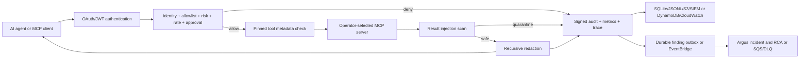

# Judikt

Judikt is a deterministic security and reliability control plane for Model Context Protocol (MCP) tool execution: it governs requests before an external tool runs, inspects untrusted results before they reach an agent, and records tamper-evident evidence for both decisions. Its core runtime needs only Python, no local model or API key, while optional profiles add authenticated Streamable HTTP, Redis, OpenTelemetry/OpenInference, Docker observability, AWS deployment, and LLM-assisted incident summaries without putting an LLM in the allow/deny path.

```bash
judikt wrap -- npx -y @modelcontextprotocol/server-filesystem /absolute/safe/path
```


## Why Judikt

An MCP server can expose operationally powerful tools to an AI agent. The interesting production question is not whether the agent can call a tool. It is whether the platform can constrain, observe, disable, and explain those calls under pressure.

## Architecture



`judikt demo` includes three separate simulated tool servers for a deterministic walkthrough. They are not loaded by normal gateway commands:

- `platform-ops`: production service health, sanitized config, logs, allowlisted diagnostics, rolling restart, and deployment rollback.
- `kubernetes`: pod status, guarded pod restart, and rollout status. It uses a safe simulator by default and can be pointed at `kubectl` with `JUDIKT_KUBERNETES_MODE=kubectl` for a controlled lab.
- `incident`: create incidents, attach correlated evidence, and read timelines.

### Content Security Pipeline

Judikt treats MCP arguments, tool definitions, and tool results as untrusted content. Each inspected string is checked directly and through normalized variants that remove invisible controls, map common lookalike and leetspeak characters, and collapse spaced-letter obfuscation. Candidate base64, hex, and URL-encoded payloads are decoded and rescanned, while strings from the same object are also joined for a bounded pass that catches instructions split across JSON fields.

Findings carry `low`, `medium`, or `high` severity plus their surface. The default `inbound_content_inspection.thresholds` block tool descriptions and arguments at medium, while tool results block at high, redact only the affected span at medium, and record low findings. More than `max_medium_findings` (default `3`) quarantines the whole result. Fenced code, inline code, and quoted lines are scanned only for high-severity signals. Oversized results scan both ends of the configured byte budget and record `scan_limit_exceeded`; oversized tool metadata still fails closed. Findings contain rule names, JSON paths, and evidence hashes, never matched text.

On Judikt's 178-sample held-out, project-authored test split, the redesign preserved 98.57% overall recall while raising precision from 46.94% to 100% and reducing false-positive rate from 72.22% to 0%. Tool-result recall remained 100% and false-positive rate fell from 72.22% to 0%. These are repository regression-corpus results, not a claim about arbitrary production traffic. See the [baseline dev](docs/evidence/content-guard-baseline-2026-10-23-dev.json), [baseline test](docs/evidence/content-guard-baseline-2026-10-23-test.json), [redesign dev](docs/evidence/content-guard-redesign-2026-10-23-dev.json), and [redesign test](docs/evidence/content-guard-redesign-2026-10-23-test.json) evidence.

This is defense in depth, not a claim of complete semantic detection. The multilingual rules cover a deliberately small set of high-value phrases, and novel paraphrases can evade deterministic patterns. Judikt therefore combines content inspection with policy enforcement, scoped credentials, metadata pinning, approvals, isolation, audit evidence, and kill switches. An optional future detector for ambiguous medium findings is scoped in [docs/SEMANTIC_DETECTOR.md](docs/SEMANTIC_DETECTOR.md); it is not implemented or enabled.

## Quick Start

Requirements: macOS or Linux and Python 3.11+.

Install from a checkout:

```bash
python3 -m pip install .
```

Wrap any stdio MCP server with one command. Judikt discovers `tools/list`, creates an annotation-derived starter policy (read-only by default), and exposes only its authorized catalog over stdio:

```bash
judikt wrap -- npx -y @modelcontextprotocol/server-filesystem /absolute/safe/path
```

Use this command directly in an MCP client configuration:

```json
{
  "mcpServers": {
    "guarded-filesystem": {
      "command": "judikt",
      "args": [
        "wrap",
        "--",
        "npx",
        "-y",
        "@modelcontextprotocol/server-filesystem",
        "/absolute/safe/path"
      ]
    }
  }
}
```

To review and customize a persistent annotation-derived starter policy first, generate one from the upstream's actual catalog:

```bash
judikt init \
  --name filesystem \
  --output judikt-policy.json \
  -- npx -y @modelcontextprotocol/server-filesystem /absolute/safe/path

judikt wrap \
  --policy judikt-policy.json \
  --name filesystem \
  -- npx -y @modelcontextprotocol/server-filesystem /absolute/safe/path
```

The packaged default policy is deliberately neutral and fail-closed. `judikt init` and policy-free `judikt wrap` classify discovered tools from their names and MCP annotations. Annotations are self-reported by the upstream, are not trusted security facts, and can only make the generated policy stricter than the name check. Every generated policy is a starting point that must be reviewed. Anonymous callers receive no permissions, and `judikt init` refuses to overwrite an existing file unless `--force` is supplied.

Generated-policy profiles:

| Profile | Generated behavior |
| --- | --- |
| `read-only` (default) | Advertise and allow only tools with `readOnlyHint: true` whose names contain no mutation segment. |
| `approve-writes` | Allow all discovered tools, but require a signed approval token for every write or destructive tool. |
| `permissive` | Allow every discovered tool without generated approval gates and print a warning to stderr on every generated-policy start. |

Tools without annotations are destructive by default. A read-only annotation that conflicts with a mutation-like name such as `delete_cache` is also classified as destructive. The generated policy records every decision under `tool_classification`; this key is informational and ignored during policy evaluation. Pass `--profile` to `judikt init` or policy-free `judikt wrap`. When `judikt wrap --policy ...` is used, Judikt uses that explicit policy as-is and does not reclassify it.

When neither `--audit-db` nor `JUDIKT_AUDIT_DB` is set, each wrapped upstream gets private state under `$XDG_STATE_HOME/judikt/upstreams/<display-name>-<fingerprint>/` (or `~/.local/state/judikt/upstreams/...`). The fingerprint binds the resolved command, working directory, and configured environment-variable names without storing their values. Its `audit.db`, findings database, and tool-pin file are therefore isolated from unrelated upstreams and concurrent writers.

Tool pins use schema v2: an overall digest, upstream fingerprint, safely quoted launch command, pin time, and per-tool digests for the complete definition plus `description`, `inputSchema`, `annotations`, and `outputSchema`. Legacy digest-only pins are read and upgraded after a successful verification. Tool drift or metadata quarantine exits startup with status `3`, writes only safe tool and field names to stderr, and never prints upstream schema or description contents. Review and explicitly accept changes with:

```bash
judikt pins list
judikt pins show <state-key>
judikt pins accept <state-key> --tool <tool-name> --yes
# Omit --tool to accept the complete current catalog; omit --yes for confirmation.
```

`JUDIKT_TOOL_PIN_MODE=refresh` remains available for compatibility but warns because it re-trusts every server in the selected pin file.

The launch scripts automatically use `.venv/bin/python` when a project virtual environment exists. Otherwise, they use the system `python3`.

To use an isolated audit database for a run:

```bash
./scripts/run_demo.sh --audit-db /tmp/judikt-demo.db
```

```bash
./scripts/run_demo.sh
```

Common developer commands:

```bash
make test
make demo
make demo-recording
make eval
make attackbench-smoke
make performance-smoke
make failure-test
make interop-community
make trace
make observability-up
make helm-template
```

`make test` is the canonical release gate for all Tier 1, Tier 2, and Tier 3 work. It provisions isolated Redis and Vault containers, runs the complete unit/integration/end-to-end suite once, enforces aggregate and security-critical branch coverage, executes adversarial and failure drills, measures guarded-call performance, and verifies the pinned official Filesystem and Memory MCP servers. Existing Redis and Vault endpoints can be supplied through `JUDIKT_TEST_REDIS_URL`, `JUDIKT_TEST_VAULT_ADDR`, and `JUDIKT_TEST_VAULT_TOKEN`.

Start the dashboard:

```bash
./scripts/run_dashboard.sh
```

Then open [http://127.0.0.1:8080](http://127.0.0.1:8080). The page includes buttons for allowed calls, blocked calls, an approved rollback drill, secret redaction, and kill-switch testing.

Loopback is the only unauthenticated mode. Binding to any other interface fails
closed unless `JUDIKT_API_TOKEN` is set. The browser asks for the token once
and keeps it in session storage.

To expose upstreams from a persistent [`config/upstreams.example.json`](config/upstreams.example.json) configuration instead of the one-line wrapper:

```bash
./scripts/run_mcp_gateway.sh
```

Unauthenticated stdio sessions take their identity only from `local_stdio_identity` in the policy file; authenticated remote sessions use the validated subject. Tool arguments are forwarded unchanged for policy evaluation, approval hashing, auditing, and upstream execution. The `identity_argument_fields` policy key is a list of argument names that may act as identity claims only when no trusted identity exists; its default is `[]`, while the demo policy opts into `["actor"]`. When a trusted identity exists, a conflicting value in an opted-in field is denied with `identity_mismatch`. Use a separate local policy file when different MCP client installations need different principals.

For a checkout-based MCP client configuration, use:

```json
{
  "mcpServers": {
    "judikt": {
      "command": "/absolute/path/to/Judikt/scripts/run_mcp_gateway.sh"
    }
  }
}
```

### External MCP Servers

Set `JUDIKT_UPSTREAM_CONFIG` to a JSON file using the shape in [`config/upstreams.example.json`](config/upstreams.example.json). Commands are executed directly without a shell. Sensitive upstream credentials should use `from_env` or `from_aws_secret`; caller-supplied OAuth tokens are denied recursively by policy.

Upstream requests default to 30-second `initialize` and `tools/list` deadlines and a 120-second `tools/call` deadline. Set `JUDIKT_UPSTREAM_TIMEOUT_SECONDS` for one global deadline or add per-server `timeouts` with `initialize`, `list`, and `call` values in the registry. Timed-out calls receive MCP `notifications/cancelled`; crashed subprocesses restart with bounded exponential backoff and must pass tool-pin verification again before calls resume.

The `platform-ops`, `kubernetes`, and `incident` adapters are walkthrough fixtures loaded only by `judikt demo` or the explicit `JUDIKT_DEMO_MODE=true` test harness. Production gateway commands load only operator-selected upstream servers.

The test suite launches [`tests/fixtures/external_mcp_server.py`](tests/fixtures/external_mcp_server.py) as an independent process and proves normal and text-only responses, paginated discovery, server-initiated requests, environment isolation, injected-result quarantine, and changed metadata blocking. The versioned [community interoperability harness](docs/COMMUNITY_INTEROP.md) separately targets the official MCP Filesystem and Memory servers plus GitHub's official read-only server.

## Security and Operations Controls

Judikt includes:

- MCP gateway proxying over JSON-RPC stdio
- Official MCP SDK Streamable HTTP server for production-facing clients
- Operator-configured proxying to independently built stdio MCP servers
- Versioned interoperability harness for official Filesystem, Memory, and GitHub MCP servers
- Minimal subprocess environments that expose only explicitly brokered upstream credentials
- Recursive tool-description and JSON Schema inspection before trust
- SHA-256 tool-definition pinning and fail-closed rug-pull detection
- Deterministic direct and indirect prompt-injection inspection across tool arguments, metadata, and results
- Evasion-resistant scanning for base64, hex, URL encoding, invisible Unicode, confusables, leetspeak, spaced-letter payloads, and injections split across JSON fields
- Narrow multilingual rules for common instruction-override and role-reassignment phrases in Spanish, French, German, Portuguese, Chinese, and Russian
- Quarantine envelopes that do not return malicious text to the agent
- Policy-as-code allowlists and blocked argument patterns
- JWT/OIDC resource-server authentication with issuer, audience, group, and scope validation
- Authenticated-subject binding that rejects caller actor spoofing
- Trusted-context identity from `local_stdio_identity` or an authenticated subject, with tool arguments forwarded unchanged
- OAuth protected-resource metadata and caller-token passthrough denial
- Scoped OAuth challenges and exact HTTP Origin validation
- HMAC-signed, single-use approval tokens for restart and rollback operations
- Slack button approvals with signed callbacks, approver allowlists, deduplication, and replay protection
- Rollback-plan enforcement before production-impacting actions execute
- Dry-run-only and shadow-mode outcomes for safe agent evaluation
- Deterministic risk scoring for production actions
- Secret redaction for audit logs and agent-visible responses
- Per-tool rate limits and immediate kill switches
- Optional Redis-backed distributed rate limits for multi-replica deployments
- Atomic Redis counters with privacy-preserving hashed actor/tool keys and live multi-instance CI
- Circuit breakers for repeated upstream tool failures
- Concurrent stdio upstream requests with deadlines, cancellation, bounded stderr capture, restart budgets, and post-restart pin verification
- Hash-chained and optionally HMAC-signed local audit evidence
- Fail-closed audit signing and full-chain startup verification for production mode
- JSONL, S3, generic HTTPS SIEM, or Splunk HEC audit shipping plus individually signed DynamoDB serverless events
- Reusable AWS Secrets Manager and Vault KV secret brokerage across runtime credentials
- Correlation IDs, Prometheus metrics, OpenInference/OpenTelemetry traces, and AWS X-Ray
- Docker Compose observability stack with Prometheus, Grafana, Tempo, Jaeger, and Redis
- Helm chart for Kubernetes deployment
- Optional Groq incident analysis with an offline fallback
- Optional OpenInference-compatible traces exported through OpenTelemetry
- MCP-38 coverage matrix and adversarial policy regression suite
- MCP-AttackBench-compatible dataset adapter with per-category metrics and privacy-safe reports
- Reproducible full-pipeline latency, overhead, throughput, and audit-integrity benchmark
- Durable blocked-finding export that creates deduplicated incidents in Argus's RCA pipeline
- AWS Secrets Manager, X-Ray tracing, IAM review, SLOs, runbooks, and failure-mode tests

## Optional Groq Integration

The demo produces a deterministic local incident summary by default. To add a hosted LLM summary:

```bash
export GROQ_API_KEY="your-key"
export GROQ_MODEL="openai/gpt-oss-20b"
./scripts/run_demo.sh
```

The gateway keeps working if Groq is unavailable. Policy evaluation never depends on the model.

## Dashboard API

| Endpoint | Purpose |
| --- | --- |
| `GET /healthz` | Readiness check |
| `GET /api/tools` | List upstream MCP tools |
| `GET /api/events` | Read recent correlated audit events |
| `GET /api/kill-switches` | Read disabled tools and servers |
| `GET /api/telemetry` | Read OpenInference tracing mode and OTLP endpoint |
| `GET /api/audit-integrity` | Verify the local audit hash chain and signatures |
| `GET /metrics` | Prometheus-style counters |
| `POST /api/call` | Invoke a guarded tool |
| `POST /api/approval` | Issue a short-lived approval token |
| `POST /api/kill-switch` | Enable or disable a tool or server |
| `POST /api/analyze` | Summarize recent audit evidence |

Example:

```bash
curl -s http://127.0.0.1:8080/api/call \
  -H 'Content-Type: application/json' \
  -d '{"server":"platform-ops","tool":"platform.health","arguments":{"service":"payments-api"}}'
```

Issue a signed approval token for a rollback:

For local single-machine use, Judikt creates `$XDG_STATE_HOME/judikt/approval.key` (or `~/.local/state/judikt/approval.key`) atomically with mode `0600` inside a mode-`0700` directory. All local commands for the same OS user share that key. Judikt refuses incorrectly owned or group/world-readable key files and rejects approval secrets shorter than 32 bytes. Remote bindings, serverless deployments, and `JUDIKT_PRODUCTION=true` require an explicitly configured shared secret through `JUDIKT_APPROVAL_SECRET`, AWS Secrets Manager, or Vault; they never fall back to the per-machine key.

Approval tokens are single-use. Judikt records the token's hashed identifier atomically immediately before upstream execution; dry-run and shadow-mode evaluations do not consume it, while an attempted call remains consumed if the upstream later fails. Local single-instance gateways use SQLite. Remote and production gateways require Redis through `JUDIKT_REDIS_URL`, unless the operator explicitly declares `JUDIKT_SINGLE_INSTANCE=true`; the serverless gateway uses DynamoDB.

Remote control-plane authorization uses explicit `read`, `execute`, `approve`, and `admin` roles mapped to JWT scopes or groups. Static bearer authentication defaults to the `execute` role through `JUDIKT_HTTP_BEARER_ROLE`; granting `admin` is explicit and produces a startup warning. The dashboard always requires `JUDIKT_API_TOKEN` for approval issuance and kill-switch changes, including on loopback.

```bash
TOKEN=$(./scripts/python.sh -m judikt.cli issue-approval \
  --actor gaurav \
  --reason "rollback after elevated 5xx rate" \
  --server platform-ops \
  --tool platform.rollback_deployment \
  --arguments '{"service":"payments-api","version":"payments-api@2026.05.2","actor":"gaurav","rollback_plan":"verify service health and restore previous release if errors increase"}')

curl -s http://127.0.0.1:8080/api/call \
  -H 'Content-Type: application/json' \
  -d "{\"server\":\"platform-ops\",\"tool\":\"platform.rollback_deployment\",\"arguments\":{\"service\":\"payments-api\",\"version\":\"payments-api@2026.05.2\",\"actor\":\"gaurav\",\"rollback_plan\":\"verify service health and restore previous release if errors increase\",\"approval_token\":\"$TOKEN\"}}"
```

## Test

```bash
PYTHONPATH=src ./scripts/python.sh -m unittest discover -s tests -v
```

The suite exercises the actual subprocess MCP boundary as well as allow, deny, redaction, approval, kill-switch, circuit-breaker, audit, and fallback-analysis behavior.

Run the [skill acceptance suite](docs/SKILL_ACCEPTANCE.md) against a fresh wheel installation:

```bash
./scripts/run_skill_acceptance.sh
```

Run the adversarial eval harness:

```bash
./scripts/run_evals.sh
```

The evals cover unsafe diagnostics, direct prompt injection, token passthrough, unapproved destructive actions, unknown tools, safe diagnostics, health checks, and audit redaction. The report also validates all 38 entries in [`config/mcp38_coverage.json`](config/mcp38_coverage.json): currently 12 covered, 21 partial, and 5 explicitly not covered under the definition stored in that file.

The separate [MCP-AttackBench-compatible evaluator](docs/ATTACKBENCH.md) reads JSONL, JSON, CSV, or optional Parquet datasets and reports accuracy, precision, recall, F1, false-positive/negative rates, per-category coverage, latency percentiles, throughput, and input/policy digests. Judikt publishes a pinned result for all 1,053 rows in GenTelLab's public development file and labels its low recall openly; the authors' 70,448-sample MCP-AttackBench corpus remains unreleased and is not claimed as evaluated.

Run the failure-mode harness:

```bash
./scripts/run_failure_tests.sh
```

It validates approval gates, kill switches, circuit breakers, redaction, and rate limits.

## Docker

Build and run the production-facing real MCP container:

```bash
make docker-build
docker run --rm -p 8080:8080 \
  -e JUDIKT_HTTP_BEARER_TOKEN="local-dev-token" \
  judikt:local
```

The container binds to `0.0.0.0`, so startup fails closed unless bearer/JWT auth is configured or `JUDIKT_ALLOW_UNAUTHENTICATED_REMOTE=true` is explicitly set for an isolated lab.

The container defaults to the official MCP Streamable HTTP server:

```text
GET  /healthz
GET  /metrics
POST /mcp
GET  /mcp
```

Use a bearer token for remote demos:

```bash
docker run --rm -p 8080:8080 \
  -e JUDIKT_HTTP_BEARER_TOKEN="$(openssl rand -hex 24)" \
  judikt:local
```

To run the dashboard container instead:

```bash
docker run --rm -p 8080:8080 \
  -e JUDIKT_MODE=dashboard \
  -e JUDIKT_API_TOKEN="$(openssl rand -hex 24)" \
  judikt:local
```

Dashboard API clients must send `Authorization: Bearer $JUDIKT_API_TOKEN`.
The health endpoint and dashboard page remain unauthenticated; dashboard APIs
and `/metrics` are protected.

## Real MCP Server

Judikt now includes an official MCP SDK server using Streamable HTTP. It exposes production-operations tools through the same policy, risk, approval, redaction, audit, metrics, kill-switch, rate-limit, and circuit-breaker controls used by the rest of the project.

Run locally:

```bash
export JUDIKT_HTTP_BEARER_TOKEN="local-dev-token"
./scripts/run_real_mcp_http.sh --host 127.0.0.1 --port 8080
```

MCP endpoint:

```text
http://127.0.0.1:8080/mcp
```

Drive that endpoint through the repository's official Streamable HTTP client:

```bash
export JUDIKT_MCP_URL="http://127.0.0.1:8080/mcp"
./scripts/mcp_client.sh list
./scripts/mcp_client.sh call platform.health \
  --arguments '{"service":"payments-api"}'
```

The client reads bearer authentication from `JUDIKT_HTTP_BEARER_TOKEN`, prints the exact request and structured response, recursively hides sensitive response keys, and supports mode-`0600` files for approval tokens so they do not enter shell history or terminal output.

Production-style tools exposed by the MCP server:

- `platform.health`
- `platform.read_config`
- `platform.read_logs`
- `platform.run_diagnostic`
- `platform.restart_deployment`
- `platform.rollback_deployment`
- `kubernetes.get_pod`
- `kubernetes.restart_pod`
- `kubernetes.rollout_status`
- `incident.create`
- `incident.attach_evidence`
- `incident.timeline`
- `judikt.issue_approval`
- `judikt.request_approval`
- `judikt.approval_status`
- `judikt.call_upstream`
- `judikt.set_tool_enabled`
- `judikt.set_server_enabled`
- `judikt.runtime_state`

## AWS Free-Tier Deployment

The primary complete AWS path is Terraform-managed EC2 running the official Streamable HTTP MCP container, with ECR, IAM, Secrets Manager, SSM Session Manager, and encrypted EBS. The Lambda/API Gateway/DynamoDB/EventBridge/SQS stack is a separate serverless control-plane lab with CloudWatch and X-Ray; it exercises stronger AWS serverless skills but exposes an HTTP tool API rather than claiming to be the official MCP transport. The free-tier EC2 path is a restricted-CIDR lab endpoint, not a TLS-terminated public production endpoint.

Start with [docs/AWS_FREE_TIER_DEPLOY.md](docs/AWS_FREE_TIER_DEPLOY.md) for the EC2 deployment path.

For JWT auth, Redis-backed rate limits, Grafana/Tempo/Jaeger, and Helm usage, see [docs/PRODUCTION_ENHANCEMENTS.md](docs/PRODUCTION_ENHANCEMENTS.md).

Recommended serverless command shape:

```bash
export AWS_REGION=us-east-1
export JUDIKT_API_TOKEN="$(openssl rand -hex 24)"
export JUDIKT_APPROVAL_SECRET="$(openssl rand -hex 32)"
export JUDIKT_AUDIT_HMAC_SECRET="$(openssl rand -hex 32)"
./scripts/aws/deploy_serverless.sh
```

Destroy the serverless deployment after demos:

```bash
./scripts/aws/destroy_serverless.sh
```

EC2 Terraform command shape:

```bash
export AWS_REGION=us-east-1
export JUDIKT_ALLOWED_CIDR="$(curl -s https://checkip.amazonaws.com)/32"
export JUDIKT_HTTP_BEARER_TOKEN="$(openssl rand -hex 24)"
export JUDIKT_APPROVAL_SECRET="$(openssl rand -hex 32)"
export JUDIKT_AUDIT_HMAC_SECRET="$(openssl rand -hex 32)"
./scripts/aws/deploy_terraform.sh
```

Destroy the Terraform deployment after demos:

```bash
./scripts/aws/destroy_terraform.sh
```

CloudFormation fallback:

```bash
export AWS_REGION=us-east-1
IMAGE_URI=$(./scripts/aws/build_push_ecr.sh)
./scripts/aws/deploy_ec2.sh "$IMAGE_URI"
```

Delete the CloudFormation stack after demos:

```bash
./scripts/aws/delete_stack.sh
```

## Optional OpenInference Tracing

The default demo has no third-party runtime dependencies. For AI-aware distributed traces, install the observability profile:

```bash
python3 -m pip install -e '.[observability]'
```

Print OpenInference-compatible spans to the terminal:

```bash
JUDIKT_TELEMETRY=console ./scripts/run_demo.sh
```

Export spans over OTLP HTTP to a local Phoenix instance or another OTLP-compatible backend:

```bash
export JUDIKT_TELEMETRY=otlp
export OTEL_EXPORTER_OTLP_TRACES_ENDPOINT=http://127.0.0.1:6006/v1/traces
./scripts/run_dashboard.sh
```

The trace hierarchy is intentionally security-aware:

```text
judikt.call_tool                 CHAIN
  judikt.policy.evaluate         GUARDRAIL
  mcp.platform.health               TOOL       # only created for forwarded calls
groq.incident_summary               LLM        # only created when Groq is called
```

Arguments and outputs are redacted before they are attached to spans. The remote server uses the official MCP Python SDK, while Judikt emits explicit policy, tool, and LLM spans so security decisions have stable attributes independent of auto-instrumentation. External stdio upstreams remain separate processes and do not yet propagate trace context across that process boundary.

## Threat Model

Implemented and tested controls directly address:

- Agent attempts to access sensitive local paths such as `.ssh`, `.aws`, and `.env`.
- Agent attempts to run unsafe network commands in diagnostic arguments.
- Direct prompt injection embedded in tool arguments.
- Indirect prompt injection embedded in an external MCP tool result.
- Encoded, Unicode-obfuscated, spaced-letter, confusable-character, multilingual-phrase, and split-field variants covered by the deterministic inspection rules.
- Poisoned tool descriptions, nested schema fields, exact-name shadowing, and rug pulls.
- Caller token passthrough and authenticated actor spoofing.
- Unauthorized restart or rollback actions.
- Secret leakage from upstream tool responses or recorded arguments.
- Repeated high-volume calls to expensive or destructive tools.
- Fast containment of a compromised tool or MCP server.
- Audit-record mutation and loss of local-only evidence through optional central shipping.

Explicit gaps remain: Judikt is an OAuth resource server, not an authorization server; PKCE and per-client consent belong in the chosen IdP/client flow. Its content guard is heuristic rather than a complete semantic or model-based detector, and its multilingual rules are intentionally non-exhaustive. It does not yet provide multi-tenant isolation, semantic DLP for privacy inference, complete Host-header and deployment-edge DNS-rebinding defenses beyond Origin validation, cryptographically signed policy bundles, OS-level upstream sandboxes, or complete MCP resource/prompt proxying. The coverage matrix treats these as partial or not covered rather than presenting the project as universally production complete.

## Design Notes

The short design write-up is in [docs/DESIGN_NOTES.md](docs/DESIGN_NOTES.md), the production roadmap is in [docs/ROADMAP.md](docs/ROADMAP.md), and the production operations docs are in [docs/SLO.md](docs/SLO.md), [docs/RUNBOOKS.md](docs/RUNBOOKS.md), [docs/IAM_REVIEW.md](docs/IAM_REVIEW.md), [docs/TRACING.md](docs/TRACING.md), [docs/PERFORMANCE.md](docs/PERFORMANCE.md), [docs/FAILURE_TESTING.md](docs/FAILURE_TESTING.md), [docs/CICD.md](docs/CICD.md), [docs/COMMUNITY_INTEROP.md](docs/COMMUNITY_INTEROP.md), and [docs/PRODUCTION_ENHANCEMENTS.md](docs/PRODUCTION_ENHANCEMENTS.md).

## License

This project is licensed under the Apache License 2.0. In brief, you may use, modify, distribute, and sublicense the code, including in commercial projects, as long as you preserve copyright and license notices. The license also includes an express patent grant and is provided without warranties.

See [LICENSE](LICENSE) for the full terms and [SECURITY.md](SECURITY.md) for the
supported deployment boundary and vulnerability reporting guidance.
